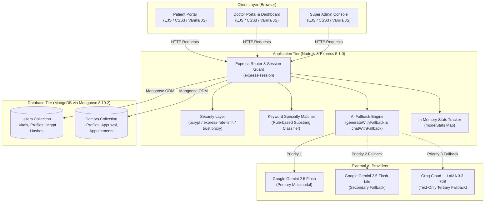
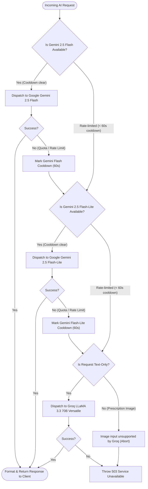
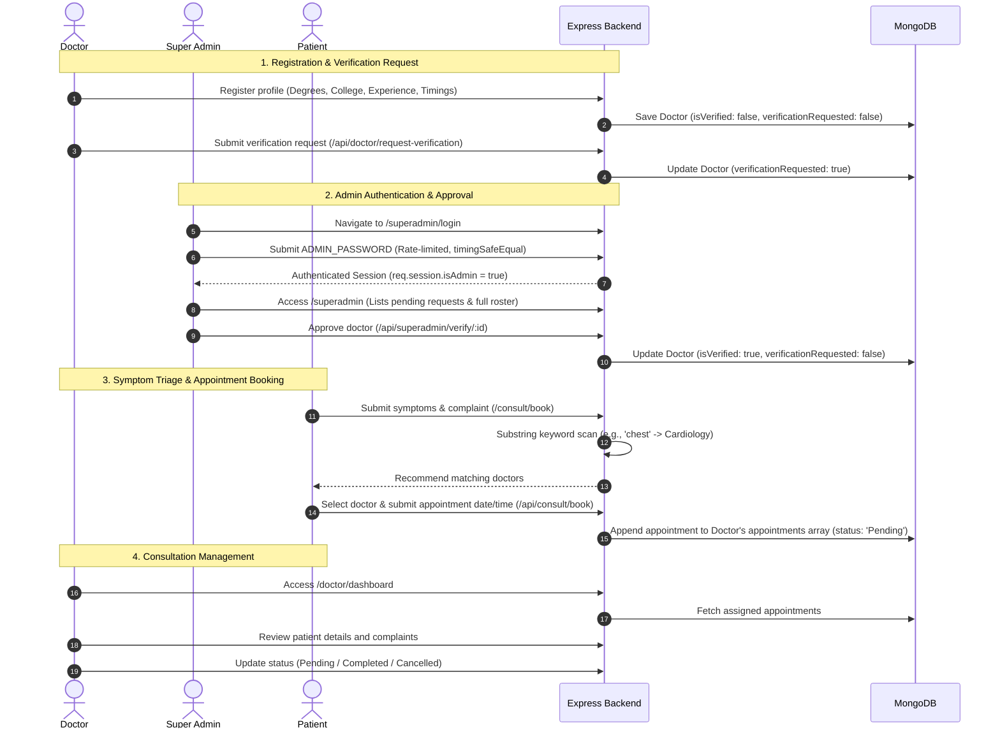
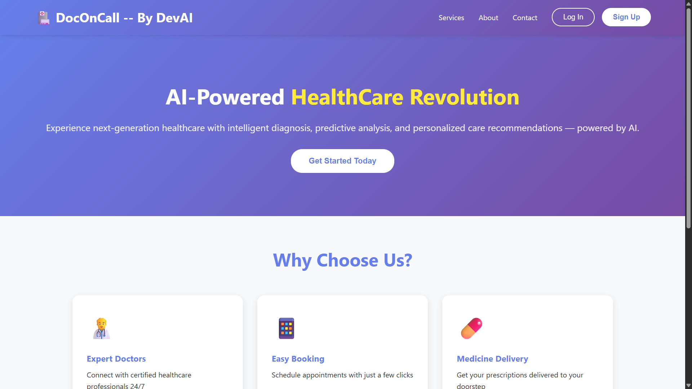
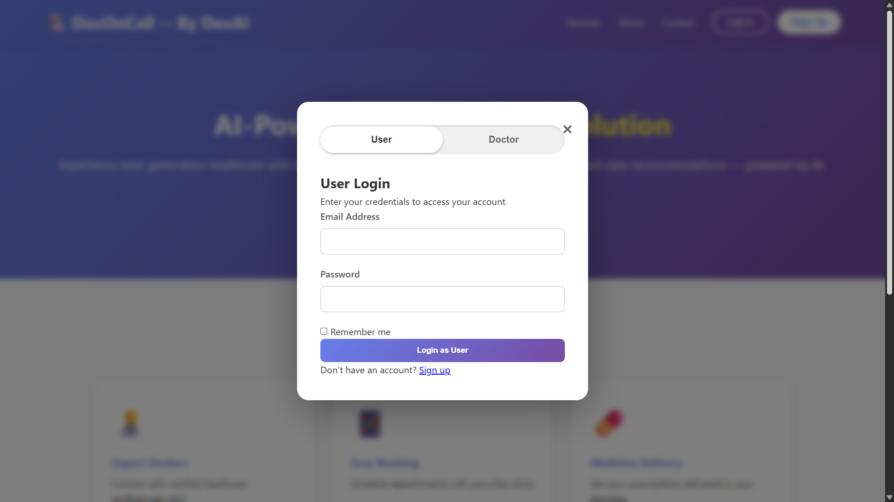
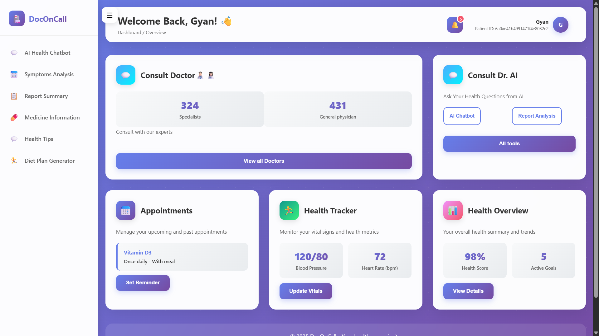
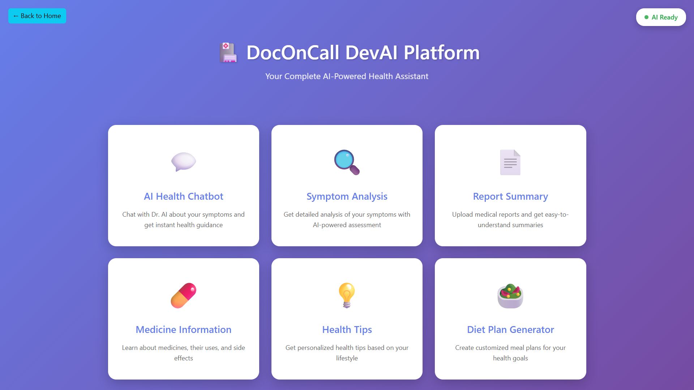
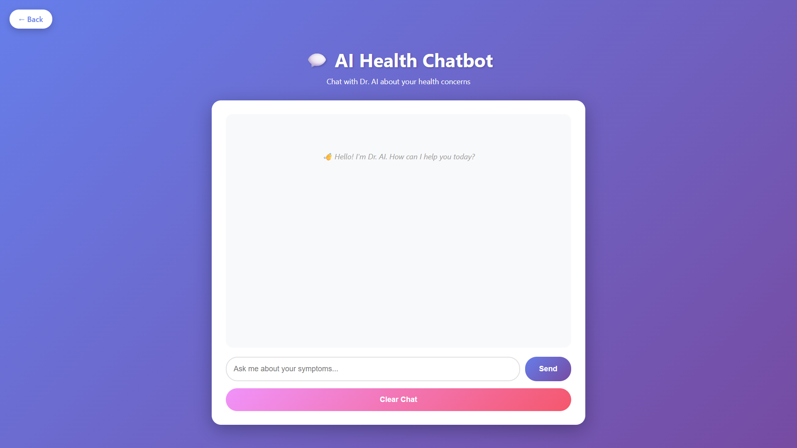
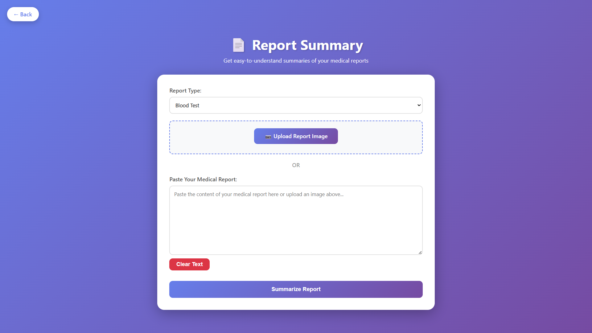

# 🩺 DocOnCall

<p align="center">
  <b>Healthcare Assistance & Doctor Consultation Web Platform</b><br>
  <i>Built with Node.js (Express 5), MongoDB, Google Gemini, Groq (LLaMA 3.3), and EJS.</i>
</p>

> [!CAUTION]
> ### ⚠️ Medical Disclaimer & Public Demo Notice
> **DocOnCall is an educational prototype and demonstration application, NOT a certified medical device or a substitute for professional clinical advice, diagnosis, or treatment.**
> - All symptom assessments, report summaries, and drug insights are generated by general-purpose Large Language Models (LLMs) and may produce inaccurate medical information or hallucinations.
> - **Do not enter real personal, identifiable, or sensitive medical information into this public demonstration prototype.**
> - Never disregard or delay seeking professional medical advice because of information provided by this application.
> - **In case of a medical emergency, immediately contact your local emergency services (e.g., 911 / 112) or visit the nearest emergency department.**

<p align="center">
  <a href="https://doconcall-by-devai.onrender.com/"></a>
</p>

> [!NOTE]
> **Hosting Notice:** The live demo runs on Render's free tier. If the instance has spun down due to inactivity, the initial page load may take **50–60 seconds** to wake the container.

<p align="center">
  
  
  
  
  
  
  
  
</p>

---

## 📌 Table of Contents

- [Overview](#-overview)
- [System Architecture & Graphs](#-system-architecture--graphs)
  - [1. System Topology](#1-system-topology)
  - [2. Multi-Model AI Fallback & Cooldown Flow](#2-multi-model-ai-fallback--cooldown-flow)
  - [3. Consultation & Doctor Approval Lifecycle](#3-consultation--doctor-approval-lifecycle)
- [Core Features](#-core-features)
  - [🤖 AI Medical Modules](#-ai-medical-modules)
  - [👨‍⚕️ Doctor Portal & Appointments](#-doctor-portal--appointments)
  - [🛡️ Super Admin Doctor Approval](#-super-admin-doctor-approval)
  - [👤 Patient Health & Profile Tracking](#-patient-health--profile-tracking)
- [Technology Stack](#-technology-stack)
- [API Reference](#-api-reference)
- [Repository Structure](#-repository-structure)
- [Getting Started & Installation](#-getting-started--installation)
  - [Production & Render Deployment Checklist](#production--render-deployment-checklist)
- [Visual Showcase](#-visual-showcase)
- [Known Limitations & Architecture Trade-offs](#-known-limitations--architecture-trade-offs)
- [Future Roadmap](#-future-roadmap)
- [Contributors & Context](#-contributors--context)

---

## 📖 Overview

**DocOnCall** is a full-stack digital health prototype created during **HackSprint 2025** by **Gyan Ranjan and Team DevStormers**, maintained under **DevAI**. The platform pairs client-facing AI health tools with a consultation appointment pipeline connecting patients to doctor profiles.

To prevent single-provider service disruptions caused by API rate limits, the backend implements an automated rate-limit cooldown and model fallback mechanism across two distinct providers: **Google Gemini** (`gemini-2.5-flash` ➔ `gemini-2.5-flash-lite`) and **Groq Cloud** (`llama-3.3-70b-versatile`).

---

## 🏗️ System Architecture & Graphs

### 1. System Topology

The platform comprises an EJS server-rendered UI, an Express.js application tier managing sessions and AI request routing, a MongoDB persistence tier, and external generative AI services:



---

### 2. Multi-Model AI Fallback & Cooldown Flow

When an AI endpoint is called, the engine attempts models sequentially according to priority. If an API returns a rate limit or quota exhaustion error (`429`, `RESOURCE_EXHAUSTED`, or quota messages), a **60-second cooldown timestamp** is attached to that model, and the request immediately advances to the next provider.



---

### 3. Consultation & Doctor Approval Lifecycle



---

## 🚀 Core Features

### 🤖 AI Medical Modules

1. **Dr. AI Virtual Assistant (`/chatbot`, `POST /api/chat`)**
   - Conversational health assistant providing preliminary medical guidance.
   - Session tracking handled via an in-memory `Map`. Every response reinforces that guidance does not replace a clinical consultation.

2. **Symptom Assessment (`/symptom-analysis`, `POST /api/analyze-symptoms`)**
   - Ingests patient symptoms, age, gender, and duration.
   - Outputs suspected conditions, model-generated likelihood estimates (High/Medium/Low, uncalibrated LLM outputs), urgency categorization, and general self-care notes.

3. **Medical Report Summarizer (`/report-summary`, `POST /api/summarize-report`)**
   - Parses clinical report text and outputs patient-oriented summaries, explaining abnormal values and suggesting questions to ask a doctor.

4. **Prescription Image Analysis (`POST /api/read-prescription`)**
   - Multimodal Gemini Vision endpoint parsing Base64 prescription photographs.
   - Extracts readable medicine names, dosages, administration frequencies, and special warnings.

5. **Medicine Directory (`/medicine-info`, `POST /api/medicine-info`)**
   - Reference for common medications: therapeutic indications, mechanism, typical side effects, and precautions.

6. **Health Tips Generator (`/health-tips`, `POST /api/health-tips`)**
   - Generates 5 practical wellness and lifestyle tips tailored by selected wellness category and demographic profile.

7. **Personalized Diet Planner (`/diet-plan`, `POST /api/diet-plan`)**
   - Produces a 1-day sample meal structure with caloric estimates and hydration tips tailored to dietary preferences.

---

### 👨‍⚕️ Doctor Portal & Appointments

- **Doctor Onboarding**: Collects profile data (specialization, degrees, medical college, years of experience, city/state, phone, consultation hours) with bcrypt salted password hashes.
- **Verification Workflow**: Doctors submit their profile for administrator review with a single click from their dashboard.
- **Appointment Queue**: Overview of scheduled patient consultations displaying patient vitals, reported symptoms, and booking date/time.
- **Consultation Status**: Update patient appointments across `Pending`, `Completed`, and `Cancelled` states.

---

### 🛡️ Super Admin Doctor Approval

- **Gated Console (`/superadmin`)**: Accessible via a dedicated admin login portal (`/superadmin/login`) requiring master passphrase authentication (`ADMIN_PASSWORD`), protected by `express-rate-limit` (5 attempts per 15 minutes) and `crypto.timingSafeEqual`.
- **Approval Actions (`POST /api/superadmin/verify/:id`, `POST /api/superadmin/reject/:id`)**: Allows an administrator to approve (`isVerified: true`) or reject pending doctor applications. *(Note: This is an administrative approval flag, not an automated medical license registry check.)*

---

### 👤 Patient Health & Profile Tracking

- **Profile & Vitals (`/about`)**: Stores physical metrics (height, weight, age, biological gender, blood group, address, and critical medical history notes).
- **Rule-Based Specialty Triage (`/consult/book`)**: Substring keyword matching on patient symptom input to categorize cases into specialties (`Cardiology`, `Dermatology`, `Neurology`, `Orthopedics`, `Pediatrics`, `General Medicine`, `Gynecology`, `Psychiatry`).

---

## 🛠️ Technology Stack

| Layer | Package / Technology | Exact Version (Installed) | Role |
| :--- | :--- | :---: | :--- |
| **Runtime** | [Node.js](https://nodejs.org/) | `>= 22.0.0` (LTS) | Asynchronous JavaScript runtime environment |
| **Framework** | [express](https://www.npmjs.com/package/express) | `5.1.0` | HTTP routing, JSON middleware, and route dispatching |
| **Template Engine** | [ejs-mate](https://www.npmjs.com/package/ejs-mate) | `4.0.0` | Server-rendered HTML templates with shared layouts and partials |
| **Database ODM** | [mongoose](https://www.npmjs.com/package/mongoose) | `8.19.2` | Schemas for Users, Doctors, and embedded Appointment subdocuments |
| **Password Hashing** | [bcrypt](https://www.npmjs.com/package/bcrypt) | `6.0.0` | Salted password hashing (12 rounds) with auto-rehash legacy upgrade |
| **Rate Limiting** | [express-rate-limit](https://www.npmjs.com/package/express-rate-limit) | `8.7.1` | Brute-force throttling on admin login and AI endpoints |
| **Session Store** | [express-session](https://www.npmjs.com/package/express-session) | `1.18.2` | Cookie-based session state (`httpOnly`, `sameSite: 'lax'`, `secure` in production) |
| **Primary AI SDK** | [@google/generative-ai](https://www.npmjs.com/package/@google/generative-ai) | `0.24.1` | Multimodal Gemini 2.5 Flash and Gemini 2.5 Flash-Lite |
| **Fallback AI SDK** | [groq-sdk](https://www.npmjs.com/package/groq-sdk) | `0.37.0` | High-speed LLaMA 3.3 70B Versatile for text-only requests |
| **CORS Middleware** | [cors](https://www.npmjs.com/package/cors) | `2.8.5` | Cross-Origin Resource Sharing middleware |
| **Method Override** | [method-override](https://www.npmjs.com/package/method-override) | `3.0.0` | RESTful HTTP PUT and DELETE verbs for forms |
| **Environment** | [dotenv](https://www.npmjs.com/package/dotenv) | `17.2.3` | Loads local environment variables from `.env` |

---

## 🔌 API Reference

### 🤖 AI Endpoints

| Method | Endpoint | Auth Required | Rate Limited | Description |
| :--- | :--- | :---: | :---: | :--- |
| `POST` | `/api/chat` | Yes (User) | 25 req/min | Chat message dispatch to Dr. AI assistant |
| `POST` | `/api/analyze-symptoms` | Yes (User) | 25 req/min | Generates structured symptom analysis and triage |
| `POST` | `/api/summarize-report` | Yes (User) | 25 req/min | Summarizes clinical lab reports in plain language |
| `POST` | `/api/read-prescription` | Yes (User) | 25 req/min | Multimodal OCR parsing of prescription photos (Gemini only) |
| `POST` | `/api/medicine-info` | Yes (User) | 25 req/min | Drug information, side effects, and precautions |
| `POST` | `/api/health-tips` | Yes (User) | 25 req/min | Category-based health and lifestyle advice |
| `POST` | `/api/diet-plan` | Yes (User) | 25 req/min | 1-day personalized meal and hydration schedule |
| `POST` | `/api/clear-chat` | Yes (User) | No | Clears an active chat session from memory |

### 👨‍⚕️ Doctor & Admin Endpoints

| Method | Endpoint | Auth Required | Description |
| :--- | :--- | :---: | :--- |
| `POST` | `/doctor/login` | No | Authenticates doctor credentials using bcrypt (auto-rehashes legacy records) |
| `POST` | `/doctor/signup` | No | Registers new doctor profile with bcrypt salted password hash |
| `PUT` | `/api/doctor/profile` | Doctor | Updates doctor bio, credentials, and office timings |
| `POST` | `/api/doctor/request-verification` | Doctor | Flags profile as awaiting admin approval (`verificationRequested: true`) |
| `POST` | `/api/consult/book` | User | Submits appointment booking with selected doctor |
| `GET` | `/superadmin/login` | No | Admin login page |
| `POST` | `/superadmin/login` | No (5 attempts / 15 min) | Authenticates master admin session via `ADMIN_PASSWORD` (timing-safe check) |
| `GET` | `/superadmin/logout` | Admin | Clears admin session |
| `GET` | `/superadmin` | Admin | Dashboard showing pending verification requests and all registered doctors |
| `POST` | `/api/superadmin/verify/:id` | Admin | Sets doctor `isVerified` flag to `true` |
| `POST` | `/api/superadmin/reject/:id` | Admin | Resets doctor verification request |

### 📊 Telemetry & System Endpoints

| Method | Endpoint | Auth Required | Description |
| :--- | :--- | :---: | :--- |
| `GET` | `/api/health` | No | Returns system status (sanitized to basic status in production) |
| `GET` | `/api/model-stats` | Yes (User) | Per-model attempt counts, failures, and cooldown status |
| `GET` | `/api/test` | Admin in prod | Internal diagnostic catalog (disabled for public callers in production) |

---

## 📂 Repository Structure

```bash
DocOnCall/
├── assets/                          # Application screenshots and demo media
│   ├── ai_chatbot.png               # AI Chatbot interface
│   ├── ai_features.png              # AI features directory
│   ├── auth.png                     # User login / signup modal
│   ├── landing.png                  # Landing page
│   ├── patient_dashboard.png        # Patient portal overview dashboard
│   └── report_summary.png           # Medical report summary tool
├── models/                          # Mongoose ODM schemas
│   ├── doctor.js                    # Doctor profile, approval flag & appointment subdocuments
│   └── user.js                      # User profile, physical vitals & hashed credentials
├── views/                           # Dynamic EJS views
│   ├── partials/                    # Shared layouts, modals, and headers
│   │   ├── footer.ejs
│   │   ├── header.ejs
│   │   ├── login-modal.ejs
│   │   ├── navbar.ejs
│   │   └── signup-modal.ejs
│   ├── about.ejs                    # Patient vitals and medical profile form
│   ├── chatbot.ejs                  # Chat interface with Dr. AI
│   ├── consult.ejs                  # Doctor directory & symptom triage form
│   ├── consult-book.ejs             # Specialist recommendation and booking confirmation
│   ├── diet-plan.ejs                # AI nutrition planner interface
│   ├── doctor-dashboard.ejs         # Doctor appointment queue and profile manager
│   ├── doctor-login.ejs             # Doctor login interface
│   ├── doctor-signup.ejs            # Doctor registration form
│   ├── error.ejs                    # Error handler view (404 / 500)
│   ├── health-tips.ejs              # Wellness tips interface
│   ├── help.ejs                     # Platform FAQs and help guide
│   ├── index.ejs                    # AI Healthcare features menu hub
│   ├── login.ejs                    # Patient login page
│   ├── main.ejs                     # Authenticated patient portal dashboard
│   ├── medical-info.ejs             # Drug directory search tool
│   ├── report-summary.ejs           # Lab report summarizer
│   ├── signup.ejs                   # Patient registration page
│   ├── superadmin.ejs               # Super Admin approval console
│   ├── superadmin-login.ejs         # Super Admin login portal
│   ├── symptom-analysis.ejs         # Clinical symptom assessment interface
│   └── welcome.ejs                  # Public landing page
├── .env.example                     # Environment configuration template
├── app.js                           # Express application, AI fallback logic & route handlers
├── LICENSE                          # MIT License
├── package.json                     # Dependency manifest and Node engines
└── README.md                        # Project documentation
```

---

## ⚙️ Getting Started & Installation

### Prerequisites

- [Node.js](https://nodejs.org/) (`>= 22.0.0` LTS recommended)
- [MongoDB](https://www.mongodb.com/) (Local installation or MongoDB Atlas URI)
- API Keys:
  - [Google AI Studio](https://aistudio.google.com/) API Key (Gemini)
  - [Groq Console](https://console.groq.com/) API Key (LLaMA 3.3)

---

### Setup Guide

#### 1. Clone the repository
```bash
git clone https://github.com/Gyan-Ranjan-01/DocOnCall.git
cd DocOnCall
```

#### 2. Install dependencies
```bash
npm install
```

#### 3. Configure environment variables
Create a `.env` file in the root directory using the provided template:
```bash
cp .env.example .env
```

Set the required environment keys:
```env
# Server Configuration
PORT=8080
SESSION_SECRET=replace_with_a_secure_random_string
ADMIN_PASSWORD=replace_with_your_admin_password

# Database Configuration
MONGO_URL=mongodb+srv://<username>:<password>@cluster0.example.mongodb.net/doconcall?retryWrites=true&w=majority

# AI Provider API Keys
GEMINI_API_KEY=your_gemini_api_key_here
GROQ_API_KEY=your_groq_api_key_here
```

*(Note: The server terminates immediately on startup if `SESSION_SECRET` is missing. If `ADMIN_PASSWORD` is unset, admin authentication fails closed with HTTP 503.)*

#### 4. Start the server
```bash
node app.js
```

The console will indicate database connection status and model fallback order:
```
🏥 HEALTHCARE AI SERVER STARTED
🚀 Server URL: http://localhost:8080
🔑 Gemini API:  ✓ Configured
🔑 Groq API:    ✓ Configured
🤖 AI Providers: Google Gemini + Groq (Multi-Model Fallback)
```

Open `http://localhost:8080` in your web browser.

---

### Production & Render Deployment Checklist

When deploying to Render or similar cloud platforms, verify the following:

1. **Environment Variables**: Set `SESSION_SECRET`, `ADMIN_PASSWORD`, `MONGO_URL`, `GEMINI_API_KEY`, and `GROQ_API_KEY` in the hosting dashboard. If `SESSION_SECRET` is omitted, the process will crash-loop.
2. **Reverse Proxy Trust**: [app.js](app.js) enables `app.set('trust proxy', 1)`. When `NODE_ENV=production` is set, Express automatically requires HTTPS to transmit the session cookie (`secure: true`).
3. **Secret Rotation**: Never reuse local development secrets or keys committed in past commits.

---

## 📸 Visual Showcase

| 🏠 Landing Page | 🔐 User Authentication |
| :---: | :---: |
|  |  |

| 👤 Patient Portal Dashboard | 🩺 AI Clinical Suite |
| :---: | :---: |
|  |  |

| 🤖 AI Medical Chatbot | 📋 Lab Report Summary |
| :---: | :---: |
|  |  |

---

## ⚠️ Known Limitations & Architecture Trade-offs

To remain candid about current engineering boundaries, the following limitations are present in the codebase:

1. **Monolithic Architecture**: All routes, database operations, error handlers, and AI fallback routines reside inside a single [app.js](app.js) file (~1,450 lines) rather than being split into modular controllers, services, and route modules.
2. **Default In-Memory Session Store (`MemoryStore`)**: `express-session` is configured with its default in-memory store. Restarting the server or redeploying the container logs out all active users and doctors. Production deployment requires migrating to a persistent session store such as `connect-mongo`.
3. **Volatile In-Memory AI State**: Active chat conversations (`chatSessions`) and AI telemetry metrics (`modelStats`) are stored in Node.js in-memory `Map` objects and reset on process termination.
4. **Prescription OCR Lacks Fallback**: Vision analysis relies exclusively on Gemini's multimodal capabilities. Because Groq's LLaMA 3.3 model is text-only, prescription image analysis cannot fail over to Groq and will return an HTTP 503 error if Gemini is rate-limited or unavailable.
5. **Basic Single-Secret Admin Authentication (No Granular RBAC)**: The `/superadmin` portal is gated by a master access passphrase (`ADMIN_PASSWORD`) with timing-safe comparison and rate limiting. It lacks individual administrator accounts, audit logs, or multi-factor authentication (MFA).
6. **Rule-Based Keyword Matching for Triage**: Doctor recommendations use substring keyword matching against patient symptoms (e.g., checking if the text includes `"chest"` or `"heart"` for Cardiology). It lacks clinical taxonomy parsing (such as SNOMED CT / ICD-10) and can misclassify complex or ambiguous clinical presentations.
7. **No Automated Testing Suite**: The repository currently does not include automated unit, integration, or end-to-end tests.
8. **No Strict Payload Validation**: Incoming POST request bodies rely on basic presence checks rather than strict schema validation libraries (such as Zod or Joi).

---

## 🔮 Future Roadmap

- [ ] **Persistent Session Storage**: Migrate `express-session` to `connect-mongo` to maintain login sessions across server restarts.
- [ ] **Role-Based Access Control (RBAC)**: Support individual admin accounts with audit trails and multi-factor authentication.
- [ ] **Modular Code Refactoring**: Split [app.js](app.js) into dedicated `controllers/`, `routes/`, and `services/` layers.
- [ ] **Persistent Cache (Redis)**: Store chat history and telemetry metrics in Redis to preserve session states across restarts.
- [ ] **Automated Test Coverage**: Introduce unit and integration tests using Jest and Supertest.
- [ ] **WebRTC Teleconsultations**: Peer-to-peer encrypted video consultations between verified doctors and patients.
- [ ] **Request Schema Validation**: Integrate Zod or Joi middleware to validate request bodies and file upload constraints.

---

## 👥 Contributors & Context

Created during **HackSprint 2025** by **Gyan Ranjan** and **Team DevStormers**; maintained under **DevAI**.

- **Gyan Ranjan** — Lead Developer & Maintainer ([GitHub](https://github.com/Gyan-Ranjan-01) • [LinkedIn](https://www.linkedin.com/in/gyan-ranjan-/))
- **Team DevStormers** — HackSprint 2025 Contributors

---

## 📄 License

This project is licensed under the [MIT License](LICENSE).
